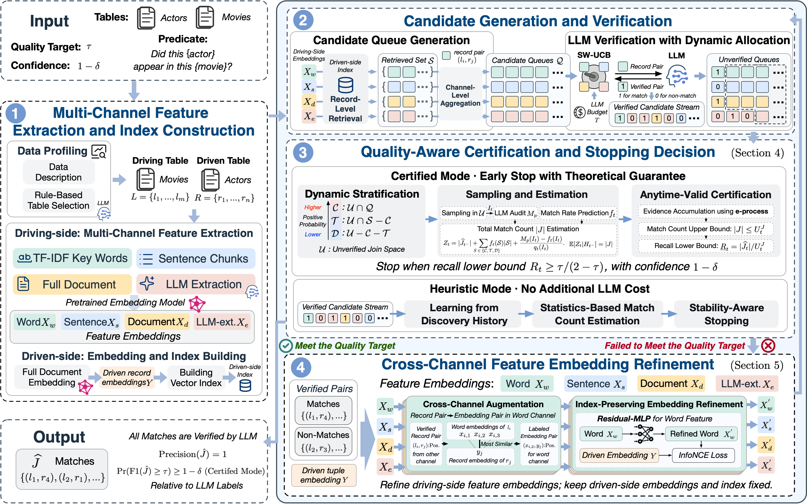

# ADAPT: Adaptive Semantic Joins with Verification Feedback and Anytime-Valid Quality Guarantees

ADAPT performs a semantic join over two tables of natural-language records. It extracts four feature channels from the driving side — word, sentence, document, and LLM extraction — and builds one shared vector index on the driven side. A sliding-window UCB policy splits each round's verification budget across the four channels. Verification feedback then trains a residual MLP that refines the driving-side embeddings. The driven-side embeddings and index stay fixed for the whole run.

There are two stopping modes:

- `certified`: stratified auditing that returns an anytime-valid recall lower bound.
- `heuristic`: a single saturating exponential \(C(x)=A(1-e^{-\beta x})\) with residual bootstrap. It estimates recall without extra audit calls.

## Setup

Install dependencies in `./`. The original conda environment is `semjoin`.

```bash
conda activate semjoin
pip install -r requirements.txt
python -c "import nltk; nltk.download('punkt'); nltk.download('punkt_tab')"
```

The default embedding model is `intfloat/e5-base-v2`. Set `EMBEDDING_MODEL_DIR` in `./.env` to use a local checkpoint. The value can be the checkpoint directory itself, or a parent directory that contains `e5-base-v2/`. If it is unset, the program downloads `intfloat/e5-base-v2` from Hugging Face.

The LLM and the optional embedding path are configured in `./.env`:

```text
MODEL=openai/Qwen3.5-397B-A17B
API_BASE=http://localhost:8002/v1
API_KEY=dummy
EMBEDDING_MODEL_DIR=/path/to/pretrained_models
```

`MODEL` is a LiteLLM model name. For a self-hosted OpenAI-compatible server, use `openai/<model name>`. `EMBEDDING_MODEL_DIR` is optional.

## Data

Each dataset is a directory `data/<name>/` that contains data only. `MovieActor` is laid out as:

```text
data/MovieActor/
├── L.parquet       # columns: Lid, <text>
├── R.parquet       # columns: Rid, <text>
├── joined.csv      # columns: Lid, Rid; used for evaluation and simulation
└── predicate.txt   # predicate with {left_tuple} and {right_tuple}
```

The first column is the row id and the second column is the text. The directory name is the value of `--dataset`.

## Run

Run from `./`.

```bash
# Certified stopping. Verify 500 pairs per round, with an F1 target of 0.9.
python -m ADAPT.main --dataset MovieActor -T 500 --stop certified --quality 0.9 --confidence 0.9

# Heuristic stopping, with no extra audit calls.
python -m ADAPT.main --dataset MovieActor -T 500 --stop heuristic --quality 0.9 --confidence 0.9

# With no quality target, run exactly --iter_num rounds.
python -m ADAPT.main --dataset MovieActor -T 500 --iter_num 8
```

`-T` and `--per_round_budget` are the same argument: the number of LLM verifications used to discover matches in one round. Certified mode also spends up to `T` additional audit calls, controlled by `--anytime_audit_ratio` (default 1.0).

Choose `T` from the number of rows in the driving table. After Adapt picks the join direction, that table is stored as L. A good default is

```text
T = |L| × 1
```

so each round verifies about one pair per driving record. `MovieActor` has 500 rows in L, which is why the examples use `-T 500`. Scale `T` in the same proportion for a larger table, and raise the multiplier when a round should verify more pairs.

`--llm_mode`:

- `normal`: every verification calls the model.
- `cache`: verification labels are stored in `cache/llm_match/<dataset>.pkl` and reused on a hit. Table descriptions, the driving/driven decision, and LLM feature extraction still call the model.
- `simulation`: verification answers come from `joined.csv`, so the join loop can run without pair-level model calls. Table descriptions and feature extraction still call the model.

The first run of a dataset writes the profiling result and the four channel texts to:

```text
cache/<dataset>/profiling.json
cache/<dataset>/features.json
```

Later runs read these files and recompute the embeddings. The cache does not include outputs from older experiments; this directory builds its own.

Results are written to `results/<llm_mode>/<run mark>/<dataset>/` as `joined_pairs.csv`, `metrics.json`, and `config.json`. Per-round metrics are in `results/logs/`.

## Pipeline

1. Sample both tables, write a description of each, and choose the driving table. From then on the driving table is stored as L.
2. Extract four channels from the driving table and encode every driven record into one Faiss inner-product index.
3. Each round, retrieve for every channel and keep the top `T` unverified pairs by inner product.
4. Sliding-window UCB assigns those `T` verifications across the four queues. Pairs that are already verified are skipped and do not spend budget.
5. Turn verified `(l, r)` pairs into cross-channel supervision. In each channel, map `l` to the original feature whose embedding is closest to `r`. The mapping is cached, and later rounds compute it only for newly verified pairs.
6. Reinitialize a residual MLP for each channel, train it with InfoNCE, and keep it only when validation MRR improves. The driven-side index is not rebuilt.
7. Stop under `certified` or `heuristic`. Otherwise return to step 3.

## Arguments

| Argument | Default | Meaning |
|---|---|---|
| `--dataset` | `MovieActor` | directory name under `data/` |
| `-T` / `--per_round_budget` | `500` | verification budget of one round |
| `--iter_num` | `10` | maximum number of rounds |
| `--stop` | `certified` | `certified` or `heuristic` |
| `--quality` | unset | target F1. If unset, the run uses every round |
| `--confidence` | `0.9` | confidence level \(1-\delta\) of the stopping rule |
| `--cuda` | `0` | GPU id. A negative value forces CPU |
| `--seed` | `114514` | random seed |
